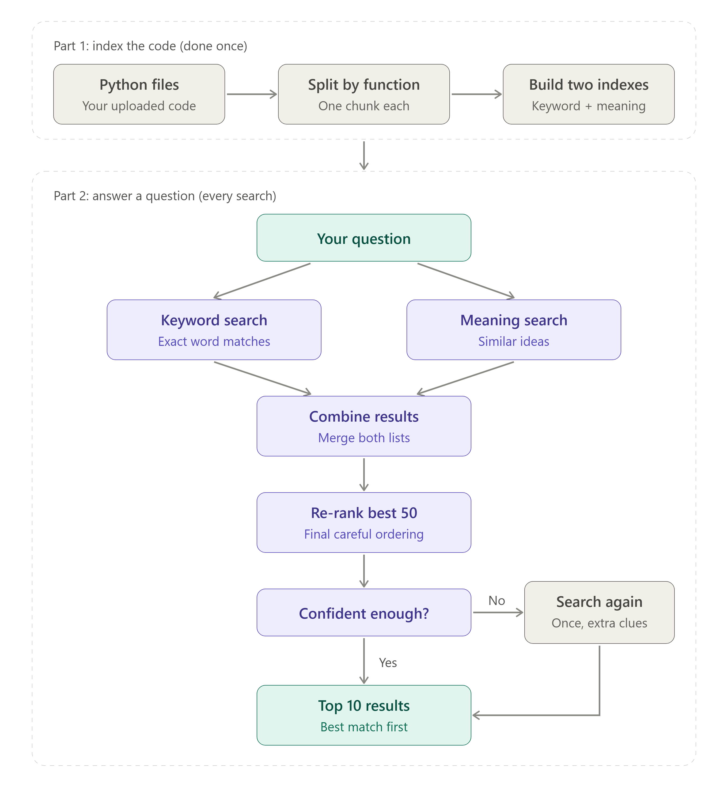

# Agentic Code Retrieval

A search system for source code. You describe what you are looking for in plain English, and it returns the most relevant functions from your codebase, ranked by relevance.

## Overview

In a large codebase, finding "the function that authenticates a user" usually means opening many files and searching by hand. This project automates that: it reads your Python files, splits them into functions, and ranks those functions against your question.

Key capabilities:

- **Natural-language search** over function-level code chunks
- **Hybrid retrieval** combining keyword matching (BM25) and semantic embeddings
- **Re-ranking** of the top candidates for higher accuracy
- **Agentic second pass**: if confidence in the first result is low, the system retries once with enriched query terms
- **Version support**: when code changes, only modified functions are re-indexed, and a function's history across versions is tracked
- **Web interface** (Streamlit) and a command-line demo

## How It Works

1. **Chunking**: Each Python file is parsed and split into individual functions with metadata.
2. **Indexing**: Every function is indexed twice: once for keyword search (BM25) and once as an embedding vector for semantic search.
3. **Query processing**: The user's question is cleaned and normalized, and code identifiers are preserved.
4. **Parallel retrieval**: BM25 and vector search each return their top 100 candidates.
5. **Fusion**: The two ranked lists are merged using Reciprocal Rank Fusion (RRF), keeping the top 50.
6. **Re-ranking**: The 50 candidates are re-scored against the query to produce the final top 10.
7. **Second pass (agentic step)**: If the top score is below a confidence threshold, extra terms are taken from the best result and retrieval is run once more.
8. **Versioning**: On a code update, content hashes identify added, modified, unchanged, and removed functions, so only the changes are re-indexed.

### Flow Diagram

<!-- Add the flow diagram image here, e.g.  -->

`[ Flow diagram placeholder ]`

## Project Structure

```
code_retrieval/
├── app.py                  Streamlit web interface
├── demo.py                 End-to-end command-line demo
├── requirements.txt        Dependencies
├── src/
│   ├── chunking.py           Splits Python files into function-level chunks
│   ├── query_processing.py   Normalizes and classifies the query
│   ├── bm25.py               Keyword (lexical) retrieval
│   ├── embedder.py           Semantic embeddings (TF-IDF or SentenceTransformer)
│   ├── vector_index.py       Cosine-similarity vector search
│   ├── fusion.py             Reciprocal Rank Fusion
│   ├── reranker.py           Feature-based or cross-encoder re-ranking
│   ├── versioning.py         Change detection and lineage tracking
│   └── pipeline.py           Orchestrates the full flow
├── eval/
│   ├── metrics.py            MRR and NDCG@10
│   ├── run_experiments.py    Ablation: BM25-only vs. full pipeline
│   └── coir_eval.py          Evaluation on the CoIR Apps benchmark
└── tests/sample_repo/      Sample codebase (v1 and v2) used by the demo
```

## Getting Started

### Prerequisites

- Python 3.10 or higher

### Installation

```bash
# 1. Go to the project folder
cd code_retrieval

# 2. Create and activate a virtual environment
python -m venv venv
venv\Scripts\activate          # Windows
source venv/bin/activate       # macOS / Linux

# 3. Install dependencies
pip install -r requirements.txt
pip install streamlit
```

### Run the Web App

```bash
streamlit run app.py
```

Open http://localhost:8501 if the browser does not open automatically. Then:

1. Upload one or more `.py` files.
2. Type a question, for example *"how is the input validated?"*
3. Expand any result to view the full function.

<!-- Add an app screenshot here, e.g.  -->

`[ App screenshot placeholder ]`

### Run the Demo

```bash
python demo.py
```

The demo indexes a sample codebase, runs several queries, simulates an update to "version 2" where only changed functions are re-indexed, and shows a function's lineage across versions.

## Modes

| | Fast mode (default) | Smart mode |
|---|---|---|
| Embedder | `tfidf` | `sentence-transformers` |
| Reranker | `feature` | `cross-encoder` |
| Internet | Not required | Required once, to download models |
| Speed | Instant | Slower |
| Semantic understanding | Limited (word-based) | Full |

In the web app, switch modes from the sidebar. In code:

```python
pipeline = CodeRetrievalPipeline(
    embedder_backend="sentence-transformers",
    reranker_backend="cross-encoder",
)
```

## Evaluation

Quality is measured with **MRR** and **NDCG@10**.

```bash
# Ablation on the sample repo: BM25-only vs. hybrid + rerank
python eval/run_experiments.py

# Real benchmark (CoIR Apps)
pip install datasets
python eval/coir_eval.py --num-queries 50 --max-corpus 2000
```

For final numbers, add `--embedder sentence-transformers --reranker cross-encoder`.

## Limitations

- Supports **Python files only**. Other languages would require a different parser (for example, tree-sitter); the rest of the pipeline is language-independent.
- Fast mode uses word-based embeddings; use Smart mode for true semantic matching.
